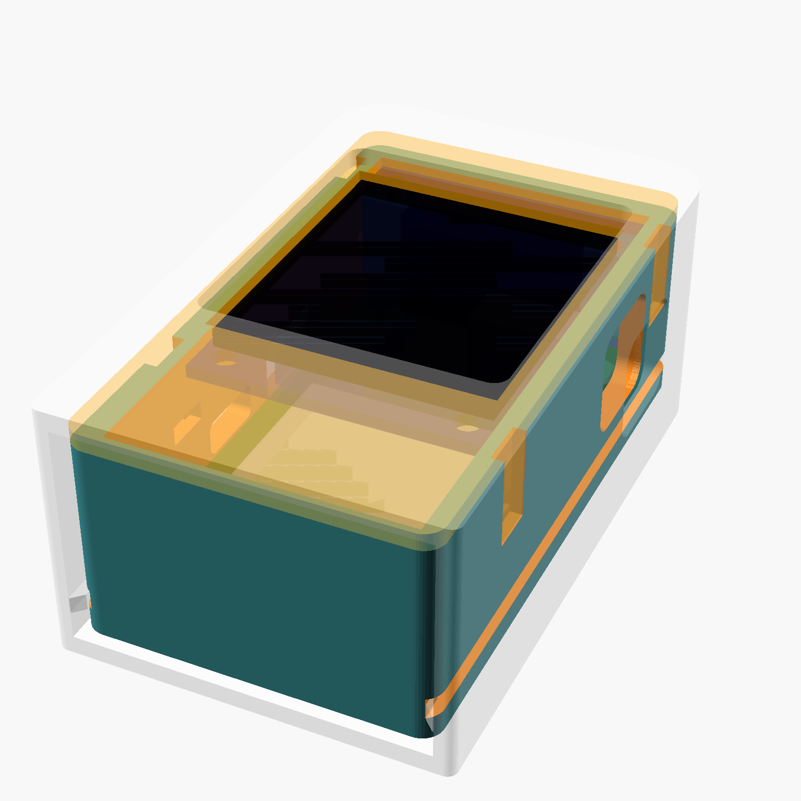
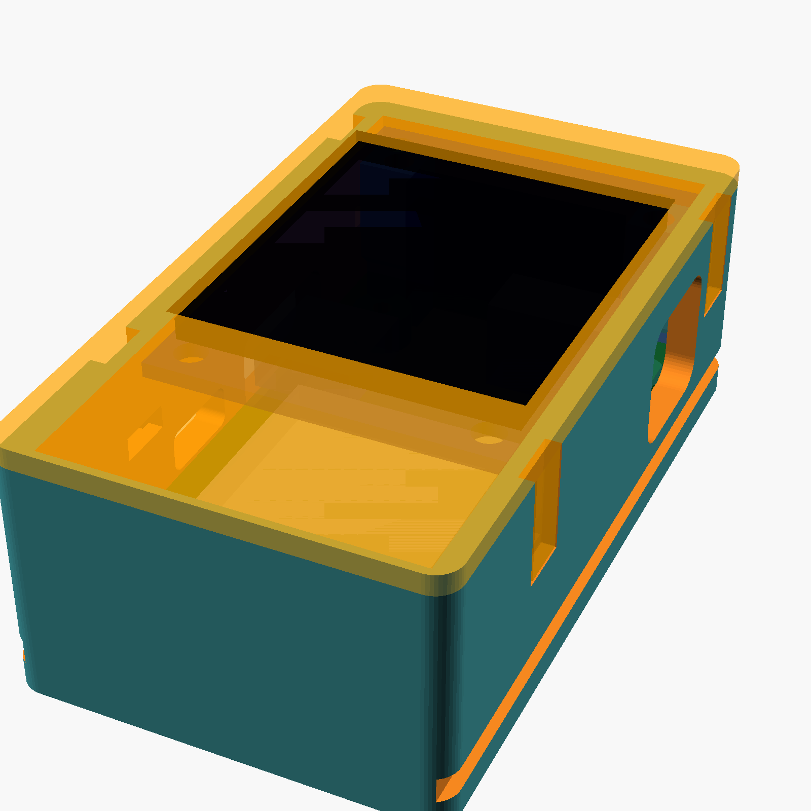
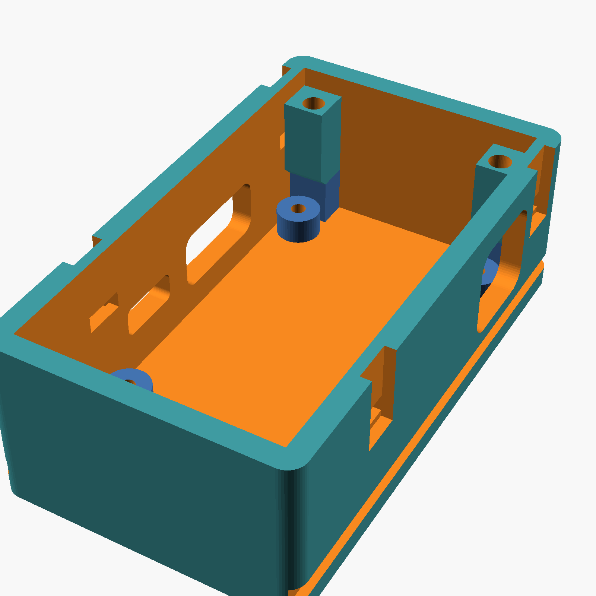
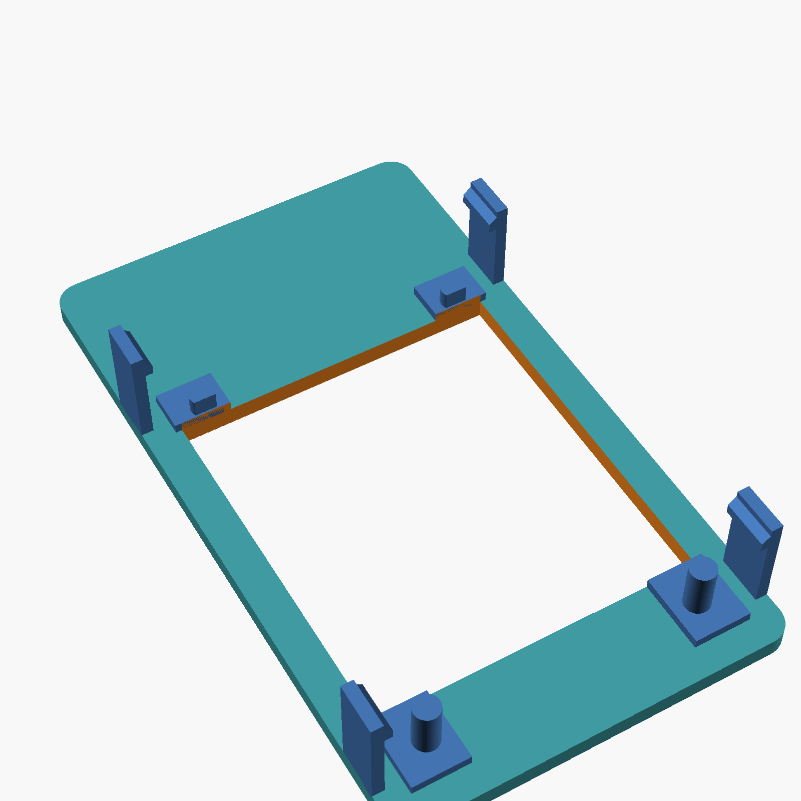
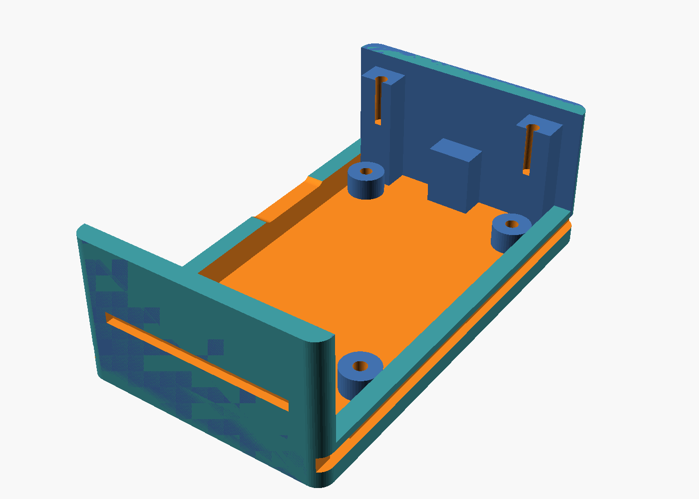
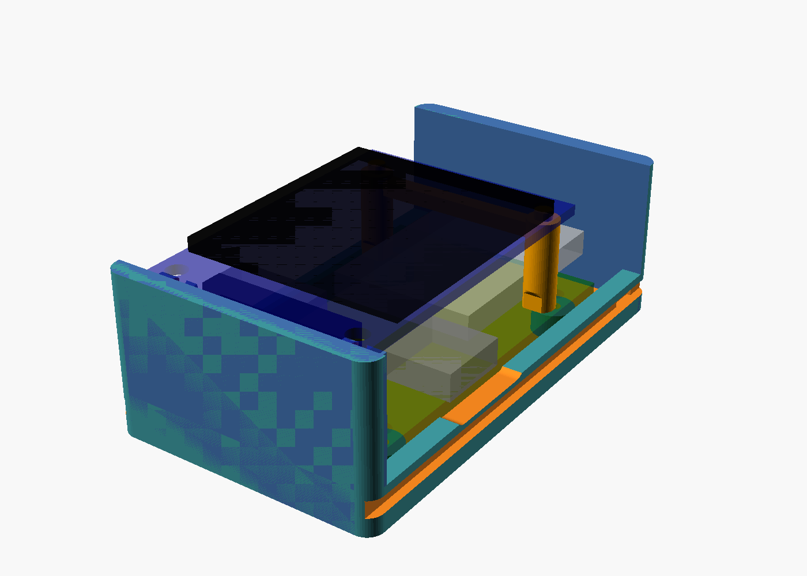
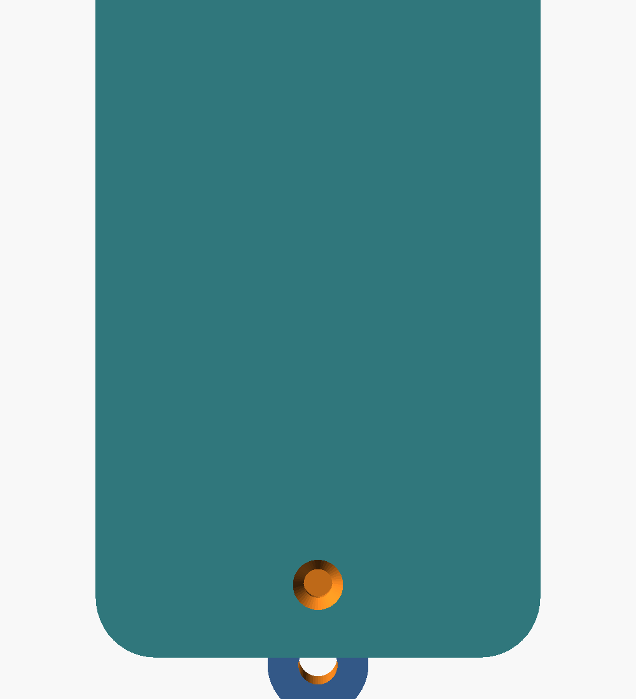
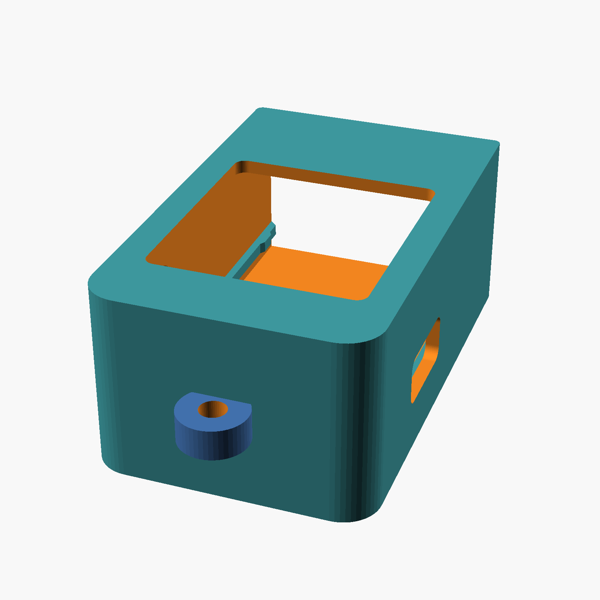
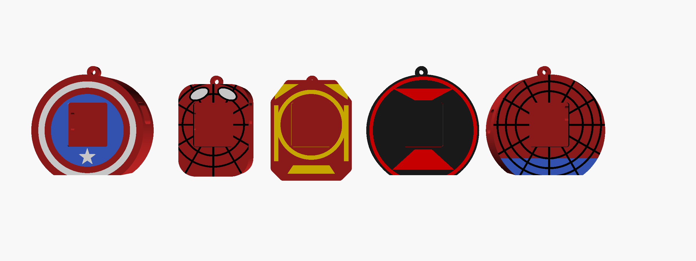

# xmas_orn enclosure: common core + swappable outers

Printed on a **Bambu Lab A1 mini** (180 mm cube, 0.4 mm nozzle). Source of truth is
[`xmas_orn_case.scad`](xmas_orn_case.scad) (OpenSCAD, parametric); `export.sh` writes the
print-oriented STLs into [`stl/`](stl/). Open the STLs in Bambu Studio as-is.

The idea is the Happy Meal handheld: one **core** that holds the electronics, and any number
of **outers** that the same core slots into. The core is the part that has to be right; an
outer only has to match the core's envelope.



## Parts

| Part | File | Print | Notes |
|------|------|-------|-------|
| Core tray | `stl/xmas_orn_tray.stl` | floor down, no supports | Holds the rev 2 board on four M2 posts, the display above it on its J1 socket |
| Core bezel | `stl/xmas_orn_bezel.stl` | face down (hooks up), no supports | Snaps onto the tray, frames the glass, pegs locate the display |
| Default outer: sleeve | `stl/xmas_orn_sleeve.stl` | standing on its open end, brim | Rounded hanging tag; the core slides in from the bottom |

Material: PETG for the bezel (the snap hooks flex 0.65 mm; PLA works but will fatigue after
a few dozen cycles). PLA is fine for the tray and outers.

Hardware: 4 x M2 x 6 mm screws, self-tapping into the 1.7 mm pilots in the tray posts.
Set `post_hole = 3.2` for M2 heat-set inserts instead.

## Core

 

Stack, from the tray floor up:

| z (mm) | What |
|-------:|------|
| 0 | tray floor top (floor is 1.6 thick) |
| 3.0 | PCB bottom on the posts. Clears the J1 and USB-C legs. |
| 4.6 | PCB top |
| 13.1 | top of J1 (8.5 mm socket) |
| 15.6 | display PCB rear: header body 2.5 sits on the socket |
| 16.8 | display PCB front, bezel pads bear here |
| 18.5 | glass front |
| 17.6 | tray wall top / bezel plate underside |
| 19.2 | bezel top (core height 20.8 incl. floor) |

The display's pin row is 4.89 mm from its top edge and J1 is 1.49 mm from the board's, so the
display overhangs the board's header edge by 3.4 mm. The tray's top wall carries two bosses in
that overhang; the bezel's top pegs go through the display's top mounting holes into them.
The bottom pegs are D-shaped locators only (those holes sit over the ornament board).

Openings in the tray walls (all in board coordinates: x from the left edge, y from the antenna
edge):

- **DC jack, right wall**: 11 x 10.4 window centred on J2 (y = 32.65), z 4.2 .. 14.6 above the
  floor. Takes a 3.5 mm plug with an overmould up to 10 mm across. Nothing sits in front of it.
- **USB-C, left wall**: 13 x 6.6 window centred on J3 (y = 26.7).
- **LED glow slot, left wall**: over D1/D2 (`led_window = false` to remove).
- **Antenna pocket**: the cavity runs 6.8 mm past the board's bottom edge so the WROOM-1's
  antenna overhang is in free air. Nothing metallic goes there.

BOOT and RST are under the display and are not reachable with the core assembled; the board
enumerates over USB for flashing anyway.

Assembly: screw the board into the tray (USB-C toward the LED slot). Plug the display onto J1.
Press the bezel on until all four hooks click into the wall slots. To open, lift the two hooks
on one side with a fingernail.



## Alternative core: one-piece sled

 

[`xmas_orn_sled.scad`](xmas_orn_sled.scad) replaces the tray + bezel with one carrier you build
the electronics onto and slide into any outer. It has the same footprint, side grooves and
detent notches as the core tray, so the sleeve and every themed outer take it unchanged
(`check_sled_in_core` shows the sled sits entirely inside the core's envelope).

| Part | File | Print | Notes |
|------|------|-------|-------|
| Sled | `stl/xmas_orn_sled.stl` | floor down, no supports | 32.8 x 56.75 x 19.2 mm. Low side rails carry the grooves; full-height end walls, the header end carries two M2 bosses for the display |
| Display bridge | `stl/xmas_orn_bridge.stl` | feet down, no supports (the bar bridges 22 mm) | Stands on the ornament PCB under the display's bottom corners, pegs in the display's bottom holes |

Hardware: 6 x M2 x 6 self-tapping (4 board, 2 display), plus 1 x M2 x 8 flat (countersunk) head
to fix the sled into the outer.

Assembly:

1. Drop the board straight in, USB-C on the left and the header at the boss end, then
   screw it down. The bosses stop 0.2 mm past the PCB edge, so the board goes straight in
   (the tray's bosses overhang the board, so it has to go in at an angle).
2. Set the bridge on the board, legs either side of the WROOM-1 can and the bar across it.
3. Plug the display onto J1 so that its bottom holes drop over the bridge pegs.
4. Put two M2 x 6 screws through the display's top holes into the bosses. Snug them, but
   don't crank them: the screws pull the display onto the bosses, 0.1 mm below where J1 sets it.
5. Slide the sled in, antenna end last, until the detents click.
6. Turn the ornament over and drive the M2 x 8 flat head through the countersunk hole in the
   back (centred, near the hanging-loop end) into the sled's fixing boss. It pulls the sled's
   floor against the back of the pocket, so it can't rattle or slide out.

To remove it, take out the back screw and pull on the nail groove across the antenna-end face.

Differences from the tray + bezel:

- **No bezel**, so the outer's front window (glass + 1.2 mm) shows a thin ring of the
  display PCB around the glass, where the tray + bezel showed the bezel rim. The top
  screws are behind the outer's front wall, so they don't show.
- **Open sides above the rails**, so you can plug into the jack and USB-C with the sled out.
  With it in, the outers' tunnels line up as before.
- **No snap hooks**, so the sled can be PLA throughout.

Fit checks, all clear: the sled and bridge against the boards (including the screw heads,
LEDs and WROOM-1 pads); the bridge against the sled; the sled and bridge against the sleeve;
and the sled pushed 8 mm out, where only the detent bumps overlap. Rebuild with
`./export_sled.sh`. See [Fixing screw](#fixing-screw) for the checks against every outer. The same unmeasured `disp_gap` caveat below applies, and here it
sets the boss and bridge heights. If the display sits on J1 at some other height above the
board, set `disp_gap` to the measured value and re-export.

## Outer interface

What an outer needs to know, all defined once in the `OUTER INTERFACE` block of the `.scad`:

| | |
|---|---|
| Envelope | 32.8 (x) x 56.75 (y) x 20.8 (z) mm, 2 mm corner radius on the long edges |
| Grooves | one per long side, 2.0 wide x 1.0 deep, 0.6 .. 2.6 above the floor top, full length and open at both ends |
| Detent notch | in each groove, 0.5 deeper, at y -6.5 .. -2.9 (antenna end) |
| Front | the bezel window (glass + 0.4) is the only thing that needs to show; the bezel's rim can be covered |
| Sides | the jack and USB windows above; an outer either exposes them or accepts that the core must come out to plug in |
| Fixing screw | M2 x 8 flat head up through the back at (`fix_x`, `fix_y`) = (13.75, 43.6), into a boss in the sled. The head seats in a 90 degree countersink with 1.8 mm of outer under it; a thicker back gets a counterbore down to that depth, so one screw length fits every outer |

The `env_*`, `groove_*`, `notch_*`, `usb_win`, `jack_win`, `glass_*` and `fix_*` variables give the
numbers, so an outer written in the same file (or one that `include`s it) never restates them.
`sleeve_cuts()` cuts the pocket, window, cable tunnels and the fixing-screw hole, and
`sleeve_rails()` adds the rails, so an outer built from those two gets all of it.

### Fixing screw

How a core is held in an outer: the rails in the side grooves locate it side to side and front
to back, and the detent bumps hold it at the end of travel. On their own the detents only hold
by friction, so a knock can slide the core out of the open bottom. The fixing screw makes it
positive: one M2 x 8 flat head through the outer's back into the sled.



The screw is at the header end, as far from the WROOM-1 antenna as the pocket allows, past the
PCB edge and under the display overhang, where the sled has room for a 9.6 mm deep boss (so
M2 x 10 also works). The tray + bezel core has no boss; with it, leave the hole empty.

Every outer was checked against the sled with the screw in place, in its own source:

| Outer | Sled + bridge + boards inside | Slide in from fully out | Screw clear of the outer | Back under the head |
|---|---|---|---|---|
| default sleeve | empty | detent bumps only | empty | 1.8 mm, flush countersink |
| v1: cap, spidey_nwh, ironman, widow, spidey_classic | empty | detent bumps only | empty | 1.8 mm, flush countersink |
| v2: cap, spidey_nwh, ironman, widow, spidey_classic | empty | detent bumps only | empty | 1.8 mm, flush countersink |
| ironman_v2b, ironman_v2c | empty | detent bumps only | empty | 1.8 mm, flush countersink |
| trapezoid_armor, reactor_medallion, stark_core | empty | detent bumps only | empty | 1.8 mm, flush countersink |

"Slide" sweeps the assembled sled from 70 mm out to home; the only overlap at any point is the
0.25 mm detent interference (2.4 mm³ total) that clicks into the notches. All the outers'
backs are flat at the same depth, so none needed the counterbore.

All body STLs were re-exported with the hole (each loses 11.9 mm³ and stays one watertight solid);
the colour inlays don't change. `validate_outers_v2.py` and `validate_selected_ironman.py` pass and
their reports are refreshed. `docs/ironman_v2b_validation.json` and `ironman_v2c_validation.json`
have no generator script, so the body hashes in them predate the hole.

## Default outer: sleeve



A rounded tag, 37 x 25 x 60 mm plus a 9 mm hanging loop with a 3.5 mm hole (front-to-back,
so the ornament faces out). 1.8 mm walls, 0.3 mm clearance to the core. The core slides in
from the bottom on two rails that ride the grooves; 0.45 mm bumps on the rails drop into the
core's notches at the end of travel. Once a plug is in the jack (or USB) the core cannot slide
out at all, since the plug passes through the sleeve wall.

The front window is the glass plus 1.2 mm, so what shows is the bezel's inner rim; the sleeve's
lip covers the bezel's outer rim and keeps the bezel on.

Print standing on the open end. The closed end bridges 21 mm across the inside, which the A1
mini does without support. Use a brim: the footprint is small for a 67 mm tall part.

## Themed outers: the Funko Pop! set

**Version 2:** [redesigned superhero outers, previews and printing instructions](README_outers_v2.md)
are available in `xmas_orn_outers_v2.scad` and `stl/outers_v2/`. The original version below is preserved.

[`xmas_orn_outers.scad`](xmas_orn_outers.scad) includes the case file and builds five sleeves
on the same pocket, rails, window and cable holes, one per figure on the shelf. Each is a flat
80 mm-class front with 0.8 mm colour inlays; the core slides in from the flat bottom exactly
as with the default sleeve.



| Theme | Outline | Parts (colour) |
|-------|---------|----------------|
| `cap` | shield, 80 mm disc | body (red), `white` rings + star, `blue` centre |
| `spidey_nwh` | mask, 50 x 66 | body (red), `black` web + eye outlines, `white` eyes |
| `ironman` | chest plate, 58 x 79 | body (red), `gold` reactor ring, side bars, plates |
| `widow` | emblem, 80 mm disc | body (black), `red` rim + hourglass |
| `spidey_classic` | web disc, 80 mm | body (red), `black` web, `blue` lower suit |

`./export_outers.sh` writes one STL per colour into `stl/outers/<theme>/`, all standing on the
flat bottom in the same coordinates. In Bambu Studio drag a theme's STLs in together, answer
**Yes** to "load these files as a single object with multiple parts", and give each part its
filament. Print standing on the flat with a brim, as for the default sleeve. The inlays are on
a vertical face, so no colour change happens across layers and the purge is small.

Filament: red and blue PLA are on hand. The set also needs **white** (cap, spidey_nwh),
**black** (spidey_nwh, widow, spidey_classic) and **gold or yellow** (ironman) PLA. The grey
PETG is not usable here; PETG and PLA do not bond in one print.

The thick bodies get tunnels for the plugs: the jack and USB holes run out to the rim, and a
wider finger recess on the outside lets you grip a plug that is 20 mm inside the body.
`check_<theme>` parts render the intersection with the core; all are empty.

## Things to measure before trusting the numbers

Everything above came from the KiCad board and the display vendor drawing, not from parts in
hand. The parameters most likely to need a nudge:

- `disp_gap` (11.0): socket height plus the display header body. If the display sits higher or
  lower the bezel pads and pegs are the first thing to bind; the hook slots have 0.4 mm slack.
- `glass_top_off` (6.2): where the glass starts below the display's top edge. The vendor drawing
  does not dimension it; it is inferred from the pin row and the 29.22 mm glass length. If the
  window is off, change this one number.
- `jack_win`: sized from the DC-002 3D model in the project (body 11.3 x 5.0 x 7.3, barrel axis
  4.6 above the board). Generous on purpose.
- `disp_hole_d` (2.5): the display's mounting hole size, undimensioned in the drawing.

`part = "check_*"` renders the intersections used to verify the design: tray vs boards, bezel
vs boards, bezel vs tray, sleeve vs core, and sleeve vs core pushed 8 mm out (only the detent
bumps should overlap). All are empty except the last.

## Rendering

```sh
./export.sh                       # all three STLs, print orientation
openscad -D 'part="assembly"' xmas_orn_case.scad     # everything, with mock boards
```

OpenSCAD 2026.09 snapshot from `brew install --cask openscad@snapshot`; the stable cask is
currently disabled on macOS.
